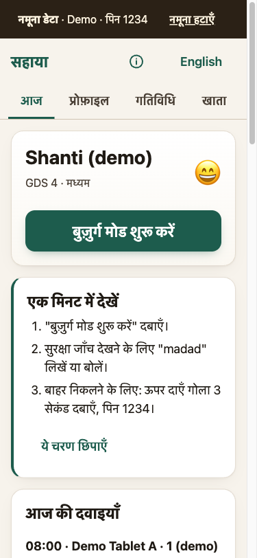
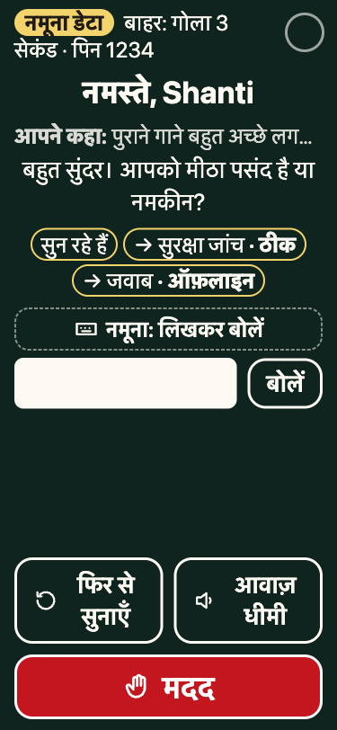
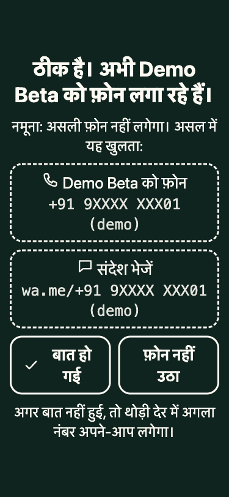
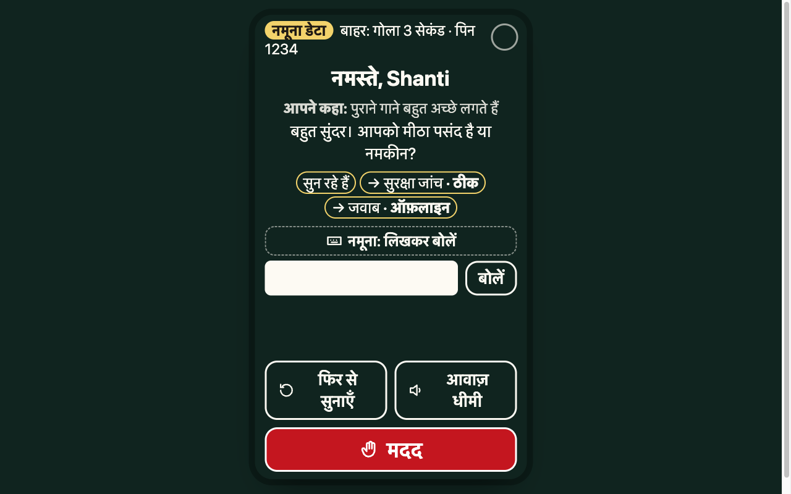

# Sahaya

A gentle, voice-first companion for an older person living with dementia, set up by their family caregiver.
Hindi first, English too. Works offline on a low-cost Android phone as an installable web app (PWA).

**Live demo:** https://shriniwas2412.github.io/sahaya/ (live after the first GitHub Pages deploy; opens in demo mode with synthetic data, no server, nothing is dialled)


> **All demo data is synthetic.** The residents, conversations, dose histories and incidents in the demo are generated by code for illustration. They are not field results and no real person's data is in this repository.

> **Not a medical device.** Sahaya does not diagnose, assess a dementia stage, or give medical or dosage advice.
> Medicine support is a reminder with a "Taken" button and a caregiver alert. Nothing more.

## Screenshots

Demo data only.

| Caregiver home | Elder screen | Help, in demo | Desktop |
|---|---|---|---|
|  |  |  |  |

## What it does

**Caregiver setup (7 steps).**
- Name, age or birth decade.
- Dementia stage on the Global Deterioration Scale (GDS 1–7), with one plain line per stage. The caregiver picks the stage a doctor or assessor gave, or "Not assessed". The app never guesses a stage.
- Language and dialect: Hindi, Bundeli, Malwi, Chhattisgarhi, Marathi (Varhadi), Gujarati, English.
- Likes, topics to avoid, words that mean they need help, energy pattern, evening restlessness (sundowning) window, life-story notes.
- Family contacts in call order, plus an optional helpline. Two helplines are offered as choices: Elderline 14567 and 112. Nothing is preselected.
- Medicines: name, dose as written on the prescription, times, instructions, and an escalation delay (default 30 min).
- Elder-mode PIN (4–6 digits, stored only as a salted PBKDF2 hash on the phone) and a recorded consent: storage, and separately sync to an account and voice listening. Consent can be changed later in Profile; each change is a new consent record.

**Locked elder mode.**
- One calm, dark, high-contrast screen that does not scroll (checked at 360×640): the person's name, what they said ("आपने कहा: …") and Sahaya's reply, one main action, "say again", louder/softer, and Help as a fixed footer. On a desktop it is shown framed as a phone.
- A small strip shows each turn passing through सुन रहे हैं → सुरक्षा जांच → जवाब (listening → safety check → reply), and whether the reply was offline/scripted or from a model.
- The main action is a big warm Talk button. If listening is not available (or not consented), it becomes four picture buttons: yes, no, song, story.
- Today's medicine appears here when it is due, with its time ("8 बजे की दवाई") and "ले ली / Taken" or "थोड़ी देर में / In a little while". Missed or older doses are shown only to the caregiver, so an old dose can never be taken late or twice from this screen.
- The companion's name is "Sahaya" by default; the caregiver can rename it.
- Leaving elder mode: hold the top-right circle for 3 seconds (touch, mouse or keyboard), then enter the PIN. Five wrong PINs lock the pad for 30 seconds, and closing the pad does not reset that.

**Every turn runs in a fixed order:**
1. A deterministic safety screen, on the phone, before anything else. It is a hand-written keyword list: Hindi in Devanagari and romanised, English, plus basic Marathi and Gujarati words for help, falls and chest pain that still need native-speaker review, plus the caregiver's own words. It will miss phrasings it has not seen; the Help button and the silence checks are the backstop. Known phrasings are pinned in `safety.test.ts`.
2. The caregiver's avoid-list. A match gets a gentle change of topic.
3. A stage-aware reply. By default this is an offline scripted companion. Optionally, a model on the user's own Groq or OpenRouter key, or Ollama. A model that is not on this same computer runs only when the elder's consent record allows it (`scope_llm_cloud`); it then gets a minimal prompt (first name, language, stage guidance without the stage number, likes and topics to avoid, time of day) and the last 4 exchanges. Account shows this list word for word.
4. An output guard that caps length by stage, strips lists and markdown, and blocks common medicine, dose and diagnosis phrasings, including "don't take / stop your medicine" (see `outputGuard.test.ts`).

**Help and emergencies are scripted, with no model involved.**
1. The companion asks "मैं यहीं हूँ … क्या किसी को बुलाऊँ?".
2. On "yes", or after 20 seconds with no answer at emergency level, it calls family contact 1, then 2, then the helpline. The elder does not have to report the result: 20 seconds after the call screen opens (or after the phone app hands back), it moves on to the next contact by itself.
3. Calls and WhatsApp messages open on the phone itself through `tel:` and `https://wa.me/` links. No paid SMS is used.
4. Every step is logged as a `safety_event`.
5. The caregiver gets a push alert when the phone is signed in and online (one attempt, no retry). If the elder says "no" to calling at emergency level, no call is made, but the caregiver is still told.

Long silence (two unanswered gentle checks) and bursts of rapid taps also start the flow.

**After a session**, the caregiver fills a 30-second form: mood (5 faces), topics to keep or avoid, and notes. The next session uses it to weight topics.

**Activities tab.** A caregiver-led memory activity: orientation, five words (immediate and delayed recall), and animals named in 60 s.
- It is tracked against the person's *own* first sessions. It flags sudden low orientation, and drops that hold for two sessions in a row.
- It uses its own word lists, not taken from MMSE, MoCA or any licensed test. It is **not a diagnostic test**.

**Caregiver home.** Today's medicines (with missed ones and a WhatsApp alert link), the alert history grouped into one row per incident ("“madad” · asked → contact 1 → talked"), recent sessions with mood, and a **7-day summary**: medicines taken and not confirmed per day (plain bars), sessions and minutes, the average caregiver mood, and safety alerts. The summary counts the records on the phone and nothing else; with no records it says so. It can be shared on WhatsApp as text (no number is filled in) or printed. A stopped medicine, or a time the caregiver removes, stops reminding at once; a dose that was already missed stays visible.

**Optional account and sync.** Without an account everything stays on the phone. With email + password, the caregiver's phone and the elder's phone stay in step, but only for a profile whose consent allows sync: the phone keeps everything else back ("kept on this phone"), and the server refuses it too. A server cron then sends:
- "medicine time" pushes;
- one missed-dose alert per dose to the caregiver, only after the server's own clock says the escalation delay has passed.

**Your data.** Account → "Your data": **Export all** downloads every record on the phone as JSON (plus the account's records from the server when signed in; the PIN hash and any model key are not included). **Delete all**, after typing DELETE or हटाएँ, erases everything on the phone and, when signed in, deletes the account and all its rows and push subscriptions on the server. A deleted row that syncs keeps only its id and links, never names, numbers or notes.

**About.** An "About Sahaya and its limits" page (the ⓘ button) explains the purpose, the not-a-medical-device rule, how the safety check works, what leaves the phone, and the known limits.

## Demo mode

"नमूना देखें / Try the demo" on the first screen (and the hosted demo, built with `VITE_DEMO=1`) opens a **separate local database** (`sahaya-demo`), filled by a seeded generator (`web/src/data/demoGen.ts`, seed 2412, dates relative to the day it loads). A caregiver's own data is never touched, and "नमूना हटाएँ / Clear demo data" deletes the demo database in one tap.

What it contains, all synthetic:
- **Seven residents of "Demo Ghar"** across GDS stages 2–6: Hindi (plain, Bundeli, Malwi), Marathi (Varhadi) and English, each with preferences, triggers to avoid and an evening window. A resident picker sits at the top of the caregiver home.
- **Medicines with 14–30 days of dose history** per resident: mostly taken, a few skipped, and a few missed doses that escalated to a caregiver alert (shown in the incident log).
- **Companion sessions every 2–4 days** with caregiver feedback (mood 1–5, topics to keep or avoid), and a **scripted sample conversation** for each resident's latest session. Sahaya's lines pass the same output guard and safety screen as live replies (`demoGen.test.ts`).
- **Weekly memory-activity scores**: steady for most residents, with one synthetic decline example that raises the "talk to the doctor" flag.
- **One worked incident**: Ramkali (demo) says her leg hurts → Sahaya asks → calls the first family contact → connected → closed by the caregiver.
- Fictional family numbers (+91 90000 0000x), shown masked. **No helpline is set on purpose.** The demo PIN is **1234**.
- A **"Start tour"** button: six short cards (about 70 s, auto-advancing, pausable) that walk through the residents, today's view, missed-dose escalation, the incident, feedback and elder mode.

While the demo is open:
- **Calls and WhatsApp are never opened.** The emergency screen shows the masked link it *would* open.
- **Nothing goes to a server.** Sync is refused and no caregiver alert is sent.
- **Typing stands in for the voice.** A "type what the elder says" box sends text through the same safety screen and companion.
- Every screen shows a "Demo / नमूना" banner, including elder mode.

## Voice

Free by default, with an optional upgrade:

- **Best phone voice.** Voices are ranked by name (`core/speech/voiceRank.ts`): neural voices ("… Online (Natural)" on Edge) first, then Google voices (Chrome/Android), then Apple "Enhanced/Premium", then the rest; eSpeak-style engines last. The caregiver can pick any voice and **play a sample** (Account → Voice). This is a name-based heuristic, not a quality measurement.
- **Calmer delivery.** `core/speech/prosody.ts` strips emoji and symbols, writes Hindi numbers, clock times ("08:30" → "सुबह साढ़े आठ बजे"), dates and rupees as words, and speaks short phrases with pauses: 250 ms at commas, 550 ms at sentence ends, **2.5 s after a question**. Rate 0.9 for stages 1–3 and 0.85 from stage 4.
- **Optional natural voice with your own key** (needs the elder's audio-cloud consent; the text to be spoken is sent to the provider):
  - **Sarvam AI Bulbul** (`SarvamTTSProvider`): key entered in the app, or set as `SARVAM_API_KEY` on the server and used through the signed-in, rate-limited `/api/tts/sarvam` proxy.
  - **Azure AI Speech** neural voices (`AzureTTSProvider`, hi-IN-SwaraNeural by default): key and region entered in the app.
  - If the cloud call fails, speech falls back to the phone voice. Both are tested with a mocked `fetch` (`core/speech/voice.test.ts`, `server/test/server.test.ts`); neither has been tried against the live services from this repo.
- **Pre-rendered demo lines (optional).** `npm run voice:lines` exports the scripted demo lines; `tools/prerender_demo_voice.py` renders them on a free Colab GPU with AI4Bharat's open Indic Parler-TTS (synthetic voices, no real person's voice). Check the model card's licence before publishing audio.

| Option | Cost / free tier | Hindi | Licence / terms | Latency, runs where |
|---|---|---|---|---|
| Browser Web Speech | free | depends on the phone's voices (Google हिन्दी on Android/Chrome, Microsoft natural voices on Edge) | browser/OS terms | on device (some voices are online) |
| [Sarvam AI Bulbul](https://docs.sarvam.ai/api-reference-docs/getting-started/pricing) | ₹15 per 10K chars (v2), ₹30 (v3, beta); ₹1,000 starting credits per the pricing page | built for Indic languages | commercial API | cloud, one request per phrase |
| [Azure AI Speech](https://azure.microsoft.com/pricing/details/cognitive-services/speech-services/) | free tier 0.5M neural chars/month ([Microsoft Q&A](https://learn.microsoft.com/en-us/answers/questions/1654938/text-to-speech-s0-standard-tier-0-5-million-charac)) | hi-IN neural voices (Swara, Madhur) | commercial API | cloud |
| [Google Cloud TTS](https://cloud.google.com/text-to-speech/pricing) | WaveNet 4M chars/month free, Chirp 3 HD 1M free, then paid | hi-IN voices | commercial API | cloud (not wired) |
| ElevenLabs | free 10K credits/month, non-commercial; Starter ~$5–6 ([summary](https://smallest.ai/blog/elevenlabs-pricing-plans-cost-what-you-get-in-2026)) | multilingual models | commercial API | cloud (stub only) |
| [AI4Bharat Indic Parler-TTS](https://huggingface.co/ai4bharat/indic-parler-tts) | free, open weights (gated) | trained for Indic languages | see model card | needs a GPU: Colab only |
| Piper | free, MIT | a community `hi_IN` voice is mirrored ([example](https://huggingface.co/pronoobie/piper-voices-hindi)); not verified in the official voice list | MIT | could run in the browser (WASM); not tried |

Prices and free tiers are from the linked pages, read on 2026-10-23; check them before relying on them.

## Run it locally

Needs Node 23.6 or later (the tests use Node's built-in TypeScript type stripping).

```bash
cd web
npm install
npm run dev          # http://localhost:5173, /api is proxied to :8787
npm test             # unit tests (node:test)
npm run build        # production PWA in web/dist
```

The server is optional for trying the app. To run it:

```bash
cd server
npm install
npm test
cp .dev.vars.example .dev.vars      # fill in JWT_SECRET; optional VAPID keys:
node scripts/vapid-keys.mjs         # prints a key pair; keep it out of git
npx wrangler d1 migrations apply sahaya --local
npx wrangler dev                    # http://localhost:8787
```

`wrangler` is not a listed dependency, so `npx` fetches it on first use.

**Demo login for the local server.** Put `DEMO_EMAIL` and `DEMO_PASSWORD` in `server/.dev.vars` (gitignored; the example file has placeholders), then:

```bash
node scripts/seed-demo.ts
npx wrangler d1 execute sahaya --local --file=.wrangler/seed-demo.sql
```

This creates (or resets) one caregiver account to sign in with on the Account tab. It is for local development only; never reuse that password.

**GitHub Pages.** `.github/workflows/pages.yml` runs the server and web tests, builds `web/` in demo mode with `VITE_BASE=/<repo>/`, and publishes it on every push to `main`. It needs no secrets, and only the deploy job gets the Pages token. One-time setup: repo Settings → Pages → Source: "GitHub Actions".

`wrangler.toml` has a placeholder `database_id`. Nothing is deployed from this repo. To deploy:
1. `wrangler d1 create sahaya`, and put the real id in `wrangler.toml`.
2. Set each secret with `wrangler secret put` (JWT_SECRET, VAPID_PUBLIC_KEY, VAPID_PRIVATE_KEY, VAPID_SUBJECT), and set `APP_ORIGIN` to the web app's origin.
3. Apply both migrations: `wrangler d1 migrations apply sahaya --remote`.
4. Host `web/dist` on any static host.

## Architecture

```
 caregiver phone / elder phone (PWA, works offline)
 ┌──────────────────────────────────────────────────────────────┐
 │ ui/ (Preact)  Setup · Home · Elder mode · Feedback · Activities│
 │      │                                                         │
 │ core/ (pure TS, unit-tested)                                   │
 │   companion/  safety → triggers → prompt/LLM or scripted → guard│
 │               emergency flow (scripted)                        │
 │   speech/     Web Speech provider, tap-only fallback           │
 │   doses.ts    pending→due→taken | snoozed→due | missed→escalated│
 │   sync.ts     LWW-CRDT per field + hybrid logical clock        │
 │      │                                                         │
 │ data/  IndexedDB repo (every write stamped) ── syncClient ─────┼──┐
 └──────────────────────────────────────────────────────────────┘  │ POST /api/sync
                                                                    │ (cookie session)
 Cloudflare Worker (Hono) + D1                                      ▼
 ┌──────────────────────────────────────────────────────────────┐
 │ /auth  PBKDF2-SHA256 + HS256 JWT cookie, rate-limited          │
 │ /sync  same CRDT merge, consent- and owner-checked, stamps     │
 │        more than 24 h ahead refused, tombstones scrubbed       │
 │ /push  VAPID Web Push (RFC 8291 / 8292), known push hosts only │
 │ /account/export, /account/delete (hard delete)                 │
 │ cron */5 min: create + advance doses (same code as the phone), │
 │   push "medicine time", one alert per missed dose, fair budget │
 └──────────────────────────────────────────────────────────────┘
```

**Why it is built this way.**
- **Offline first.** A dose confirmed on the elder's phone and a profile edit on the caregiver's phone can happen offline at the same time. The merge is field by field and does not depend on sync order.
- **Same ids on every device.** Dose rows have deterministic ids (`dose:<medicine>:<day>T<time>`), so the phone and the server create the same row and never duplicate it.
- **No paid services.** Free browser speech, no SMS gateway, and the offline companion by default.

## Measured numbers

| What | Value | Source |
|---|---|---|
| Unit tests, web (incl. evaluation checks) | 301 passing | `cd web && npm test` |
| Unit tests, server | 38 passing | `cd server && npm test` |
| Demo guard | demo load/clear, no sync, no dial (masked link preview only) | `web/src/data/demo.test.ts` |
| Dose merge | a "taken" from a phone with a slow clock still beats the server's later "due"; "escalated" beats a fast phone's "missed" | `web/src/core/merge.test.ts` |
| Elder reminders | only today's due dose is shown; a stopped or moved medicine stops reminding | `web/src/core/doses.test.ts`, `doseTick.test.ts` |
| Missed-dose alerts | a phone 23 h fast: no alert before the real deadline, then exactly one | `server/test/server.test.ts` |
| Sync consent | no consent or `scope_sync=0`: nothing sent by the phone, refused by the server | `web/src/data/syncClient.test.ts`, `server/test/server.test.ts` |
| Rate limits | 6th login after 5 wrong passwords → 429; 6th sign-up from one IP in an hour → 429 | `server/test/server.test.ts` |
| Data rights | export has no PIN hash or key; delete all removes the account, rows and push subscriptions; deleted rows carry no PII | `web/src/data/export.test.ts`, `repo.test.ts`, `server/test/server.test.ts` |
| Weekly summary | counts only stored rows; empty week = zeros and "not recorded" | `web/src/core/summary.test.ts` |
| Prompt generator | one snapshot per GDS stage 1–7 | `web/src/core/companion/prompt.test.ts` |
| Web Push encryption | byte-identical to the RFC 8291 Appendix A example | `server/test/webpush.test.ts` |
| CRDT merge | same result for 30 random merge orders of 5 devices | `web/src/core/sync.test.ts` |
| Production JS bundle | 227.6 kB, 76.4 kB gzipped (CSS 4.5 kB gzipped) | `npm run build` output |
| Text contrast, caregiver screens | ≥ 4.5:1 (WCAG AA) for the 7 text/background token pairs tested; body text 15.6:1 | `web/src/ui/contrast.test.ts` |
| Text contrast, elder mode | 15.6:1 main text (WCAG AAA ≥ 7:1) | `web/src/ui/contrast.test.ts` |
| Layout check | 16 demo-story screens at 360×640, 375×812 and 1280×800: no horizontal scroll, every control ≥ 48×48 px, text ≥ 16 px (≥ 24 px in elder mode), every control named, the elder screen never needs scrolling; in demo, zero dialling links and zero server requests | Playwright passes, synthetic data only (scripts are not in this repo) |
| Offline | after one online visit, a reload with the network off renders the app | an earlier Playwright pass; not re-run since the service worker moved to sub-path-relative URLs for GitHub Pages |
| Timings | escalation default 30 min; snooze 10 min, never past the escalation deadline; emergency auto-call after 20 s with no answer; unlock hold 3 s; LLM timeout 8 s, then the scripted reply | the tests next to `doses.ts`, `companion/emergency.ts`, `pin.ts`, `companion/llm.ts` |

## Evaluation

`cd web && npm run eval` runs everything below and writes `web/eval/report.json`; CI runs it on every push, and `eval/metrics.test.ts` fails the build if the safety numbers drop below floors set under the measured values. **All test data is synthetic and hand-written** (`web/eval/safety_set.ts`); it is a small engineering check, not a clinical or field validation.

**Safety screen** on 123 labelled utterances (49 emergency, 44 check, 30 none) in English, Hindi (Devanagari and romanised), Hinglish, Marathi and Gujarati, including negations ("dard nahi hai"), misspellings and code-mixing:

| Class | Precision | Recall | F1 | Support |
|---|---|---|---|---|
| emergency | 93% | 84% | 88% | 49 |
| check | 97% | 70% | 82% | 44 |
| any alert (check or emergency) | 96% | 78% | 86% | 93 |

False negatives (20, all listed in `report.json`): misspellings ("Hlep", "madadd", "dizy", "chaker"), indirect phrasings ("My back is aching", "मन बहुत उदास है", "पेट दुख रहा है", "बेहोशी जैसी"), English words inside Hindi ("main fall ho gayi", "breathing problem", "home jana hai"), and the Marathi/Gujarati lines for breath, fear and going home. One emergency ("My chest hurts so much") was only flagged as "check". False positives (3) are harmless uses of "help" and "गिर गए" (leaves falling). The rules were **not** tuned on this set after it was written; improving them needs a separate held-out set so the numbers stay honest. The Help button and the silence check remain the backstop.

**Stage adherence** of the offline companion (13 turns per stage, Hindi and English): 0 banned phrases (no memory quizzing, no correcting) and at most one question per turn at every stage; 5–7 words per sentence; replies within the stage's sentence limit in 92–100% of turns (the only misses are the opening greeting, one sentence over the limit, in Hindi at stages 4–7 and English at 6–7).

**Latency** in Node 25 (darwin-x64) on a laptop, offline scripted companion, 400 turns: whole turn median 0.10 ms (p95 0.13 ms); safety screen alone median 0.09 ms. Not measured on a phone, and not including speech or a network model.

## Open research questions (proposed, not done)

- **Dialect speech for older users.** How well do current Hindi ASR and TTS systems handle Bundeli, Malwi, Chhattisgarhi and Varhadi speech from people over 70? District-level spontaneous speech such as IISc/ARTPARK's [Vaani](https://vaani.iisc.ac.in) could make an evaluation set possible.
- **Does a more natural voice help?** A listening study (MOS-style ratings, plus comfort and comprehension) comparing phone voices, a cloud neural voice and an open Indic model, with informed consent from participants and caregivers and institutional ethics approval before any data is collected.
- **A safety screen that generalises.** A held-out, consented set of real distress phrasings (with negation and code-mixing) to measure recall properly, and to test whether a small on-device classifier beats keyword rules without losing determinism.
- **Stage-appropriate conversation.** Whether the stage rules (sentence length, one question, no quizzing) actually reduce confusion, measured with caregivers, not assumed.

## Limitations (please read)

- **Not a medical device.** No diagnosis, no stage assessment, no dose advice. The activity flags only point at change against the person's own earlier sessions, for a doctor to look at. They are not validated against any clinical instrument.
- **A web app cannot fully lock an Android phone.**
  - Elder mode uses fullscreen, the Screen Wake Lock API, a portrait lock where allowed, and a back-button trap.
  - The home button, the notification shade and the app switcher still work.
  - For a true kiosk, use Android's screen pinning ("App pinning") alongside the app.
- **Reminders without the server only fire while the app is open.** Browsers have no reliable scheduled offline notifications.
  - With the server, pushes need a connection.
  - The cron runs every 5 minutes, so a reminder can arrive up to 5 minutes late.
  - On iPhone, Web Push works only after the app is added to the Home Screen (iOS 16.4+).
- **Listening (speech to text).** In Chrome, speech recognition normally sends audio to Google's servers and needs internet.
  - Cloud listening is used only if the consent record allows cloud audio.
  - Without that consent, Sahaya listens only where the browser offers an on-device speech pack for the language; otherwise it uses picture buttons.
  - Speaking uses the phone's own voices; Hindi needs the Google TTS Hindi voice installed on Android.
  - Firefox has no speech recognition.
- **Languages.** The safety keywords cover Hindi (Devanagari and romanised) and English, plus basic Marathi and Gujarati words for help, falls and chest pain that need native-speaker review. Everything else in Marathi and Gujarati is missing.
  - The offline scripted companion speaks Hindi and English. Marathi and Gujarati profiles use Hindi until those banks are written.
  - Dialect (Bundeli, Malwi, Chhattisgarhi, Varhadi) shapes the model prompt only.
- **Optional model providers.** Groq, OpenRouter and Ollama are optional and off by default.
  - A key the user enters is stored unencrypted in this browser's IndexedDB.
  - Text sent to a model leaves the device.
  - Cloud voices (Sarvam, Azure) are optional, need the user's own key and audio-cloud consent, and are tested only against a mocked API. ElevenLabs is a stub; Bhashini is not wired.
- **Time zone.** Medicine times use a fixed offset (IST by default, `TZ_OFFSET_MIN` on the server). There is no daylight-saving handling.
- **Device-only data.** The PIN hash, the family photo and the extra worry words stay on the phone where they were entered and do not sync. A phone can hold several profiles (the demo has seven); the caregiver home shows one at a time with a picker.
- **Account security.** Login is rate-limited (5 wrong passwords per email in 15 minutes, 30 tries per IP in 15 minutes), sign-up is limited to 5 accounts per IP per hour, and a deleted account's cookie stops working. There is no password reset, and logging out does not end other sessions (a session lasts 30 days). Sign-up always creates a caregiver account; other roles need an admin.
- **Password hashing cost.** PBKDF2 at 100,000 iterations is heavy, and the Workers free plan allows 10 ms of CPU per request ([limits](https://developers.cloudflare.com/workers/platform/limits)), so login may fail on the free plan. Check on a real deploy.
- **Pushes.** Only known Web Push services are accepted (FCM, Mozilla, Apple, Windows), at most 5 subscriptions per account. A cron run sends at most 8 push calls, at most 3 per account, missed-dose alerts first; anything over that waits for the next run.
- **Hosting.**
  - D1's free tier enforces daily read/write limits; past them, queries fail until midnight UTC ([changelog](https://developers.cloudflare.com/changelog/post/2026-09-01-d1-free-tier-limit-enforcement/)).
  - Workers' free plan allows 5 cron triggers and 10 ms CPU per cron run ([limits](https://developers.cloudflare.com/workers/platform/limits)). Sahaya uses one.
- **Helpline numbers.** Elderline (14567, 8 am to 8 pm) and 112 are offered as choices with their sources. Check that the number works in your area before relying on it.
- **Test data only.** All screenshots, test fixtures, the evaluation set and the demo use synthetic people and sentences ("Test Elder 1", the seven "(demo)" residents, "Demo Beta", fictional 90000 0000x numbers). No real person's data is in this repository.
- **Shared code.** The sync code (CRDT + hybrid logical clock) is copied, not shared, between this repo and the Kisan app, and the two have small differences.
- **The hosted demo is a demo.** It runs only in the browser; there is no account, sync or push there.

## References

- Reisberg B, Ferris SH, de Leon MJ, Crook T. *The Global Deterioration Scale for assessment of primary degenerative dementia.* Am J Psychiatry 1982;139:1136–1139.
- Shapiro M, Preguiça N, Baquero C, Zawirski M. *Conflict-free Replicated Data Types.* SSS 2011.
- Kulkarni S, Demirbas M, Madappa D, Avva B, Leone M. *Logical Physical Clocks.* OPODIS 2014.
- RFC 8291, *Message Encryption for Web Push*; RFC 8292, *VAPID for Web Push*; RFC 8030, *Generic Event Delivery Using HTTP Push*.
- W3C, *Web Content Accessibility Guidelines (WCAG) 2.1*: contrast 1.4.3/1.4.6 and target size 2.5.5.
- Web Speech API: [MDN](https://developer.mozilla.org/docs/Web/API/Web_Speech_API) and [`processLocally`](https://developer.mozilla.org/docs/Web/API/SpeechRecognition/processLocally).
- Speech providers: [Sarvam AI text-to-speech](https://docs.sarvam.ai/api-reference-docs/text-to-speech/convert), [Azure Speech REST TTS](https://learn.microsoft.com/azure/ai-services/speech-service/rest-text-to-speech), [AI4Bharat Indic Parler-TTS](https://huggingface.co/ai4bharat/indic-parler-tts), [AI4Bharat IndicF5 on AIKosh](https://aikosh.indiaai.gov.in/home/models/details/aibharat_indicf5.html), Bhashini (MeitY, bhashini.gov.in).
- Vaani: [vaani.iisc.ac.in](https://vaani.iisc.ac.in).
- Elderline 14567, national helpline for senior citizens, Ministry of Social Justice and Empowerment: [launch notice](https://ladakh.gov.in/elderline-14567-the-national-helpline-for-senior-citizens-launched-in-ladakh/). Emergency Response Support System: [112.gov.in](https://112.gov.in/).
- ULID specification: https://github.com/ulid/spec

## License

MIT, see `LICENSE`.
